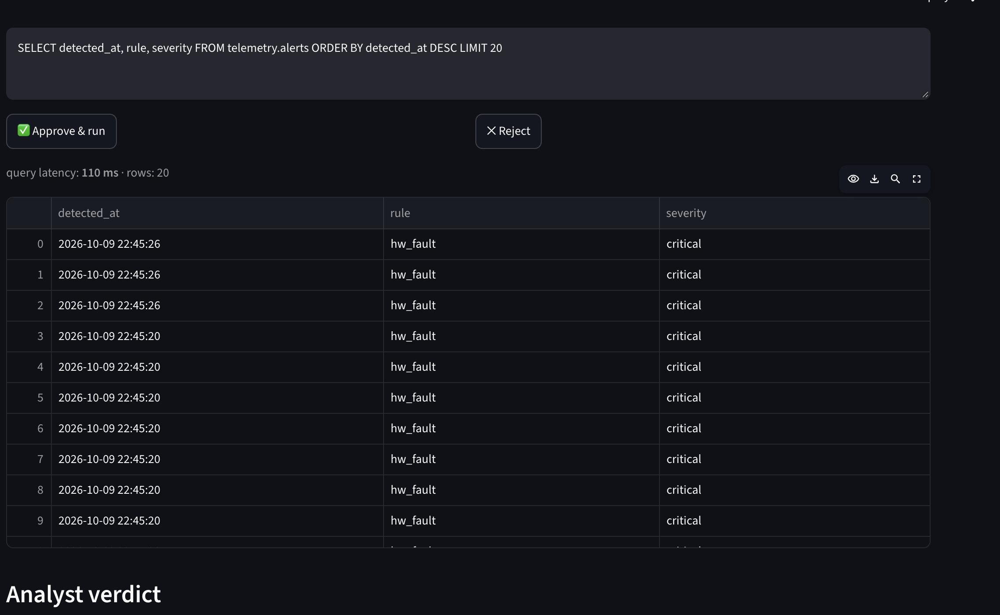
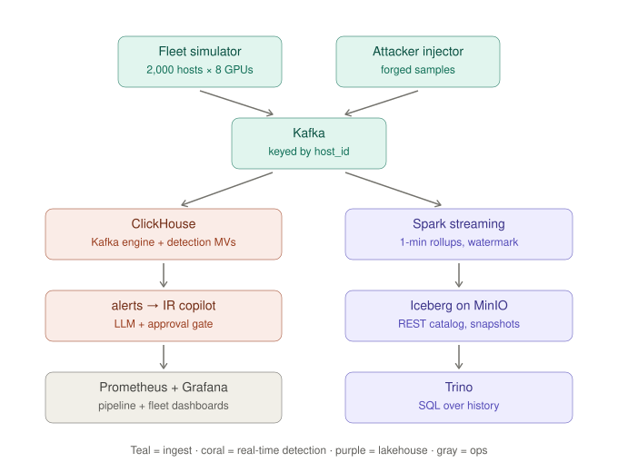

# GPU-Sentinel

**Real-time threat detection for GPU fleets — your observability pipeline is already a security sensor.**

A compromised server with 8 GPUs is worth real money to an attacker, and cryptomining on
stolen GPU compute looks like a normal training job to traditional security tools. GPU-Sentinel
detects GPU abuse from the telemetry the fleet already emits — inside the database, in seconds —
and lets any analyst investigate in plain English with an AI copilot grounded in the
organization's own incident playbooks.

**Numbers:** 3,200 rows/s live ingest · 50M+ row history · ~56 ms aggregations · <2 s event→alert



## Architecture



```
producer (2,000 hosts x 8 GPUs, DCGM-style metrics, 5s)
  → Kafka  topic telemetry.gpu.raw (8 partitions, key=host_id)
  → ClickHouse  Kafka-engine table → MergeTree storage
       ├─ MV: cryptojack_suspect   (util>95% AND sm_active<30% = fake load)
       ├─ MV: hw_fault             (ECC/XID errors → drain the node)
       └─ MV: thermal              (>92°C)          → telemetry.alerts
  → IR Copilot (Streamlit, :8501)
       question → playbook context (Senso.ai, local fallback)
       → LLM drafts SQL → HUMAN APPROVAL GATE → ClickHouse
       → verdict citing the playbook's actual steps · token/cost telemetry
  → Prometheus + Grafana (pipeline health: throughput, consumer lag)

Secondary long-retention path: Spark Structured Streaming → Iceberg on S3 (MinIO) → Trino
```

Detection happens **at insert time via ClickHouse materialized views** — no separate
detection service, so alert latency equals ingest latency.

## Quickstart

Prereqs: Docker Desktop (8 GB+ RAM), Python 3.

```bash
cp .env.example .env            # set OPENAI_API_KEY (any OpenAI-compatible provider
                                # via OPENAI_BASE_URL / OPENAI_MODEL — e.g. AkashML)
docker compose up -d --build    # first run ~5 min

# simulate an attack (cryptojack on host-0007, hardware fault on host-0013):
pip3 install kafka-python
python3 attacker/inject_incident.py

# watch detections land within ~2 s:
docker exec clickhouse clickhouse-client -q \
 "SELECT detected_at, rule, severity, host_id, detail FROM telemetry.alerts
  WHERE rule != 'thermal' ORDER BY detected_at DESC LIMIT 10"

# investigate with the copilot:
open http://localhost:8501

# data-scale demo — 50M synthetic history rows, then a timed aggregation:
docker exec clickhouse clickhouse-client --queries-file /backfill/backfill.sql
docker exec clickhouse clickhouse-client --time -q \
 "SELECT host_id, max(temp_c) FROM telemetry.gpu_metrics GROUP BY host_id ORDER BY 2 DESC LIMIT 10"
```

## UIs

| Service | URL | Login |
|---|---|---|
| IR Copilot | http://localhost:8501 | — |
| Grafana | http://localhost:3000 | admin / admin |
| Prometheus | http://localhost:9090 | — |
| Trino | http://localhost:8080 | any user |
| MinIO console | http://localhost:9001 | admin / password |
| Spark UI (while streaming job runs) | http://localhost:4040 | — |

## The copilot's agentic loop

1. Analyst asks a question in plain English
2. **Senso.ai** retrieves the org's incident playbooks (`playbooks/*.md` are the ground
   truth; local fallback keeps the demo self-contained)
3. LLM drafts SQL — SELECT-only guardrails, forced LIMIT
4. **Human approval gate**: review/edit/reject before anything touches the data
5. ClickHouse executes (latency shown per query); verdict cites the playbook's actual
   response steps (PB-001/002/003), with per-step token/cost telemetry in the sidebar

The LLM endpoint is provider-agnostic: set `OPENAI_BASE_URL`/`OPENAI_MODEL` to run open
models on **Akash (AkashML)** or any OpenAI-compatible host.

## Historical lakehouse path (optional)

```bash
docker exec -it spark spark-submit \
  --packages org.apache.spark:spark-sql-kafka-0-10_2.12:3.5.5,org.apache.hadoop:hadoop-aws:3.3.4 \
  /home/iceberg/jobs/streaming_job.py
# after ~2 min:
docker exec -it trino trino --execute "SELECT count(*) FROM iceberg.telemetry.gpu_metrics_1m"
```

Spark writes 1-minute rollups to Iceberg (schema evolution, time travel, ACID) on MinIO;
Trino serves interactive SQL over the history.

## Scaling story (laptop → 50,000 servers)

Same architecture, bigger knobs: 8 → 256 Kafka partitions (RF=3, multi-AZ), managed
Kafka + ClickHouse Cloud, DCGM-exporter instead of the simulator, real S3 + Glue catalog,
sharded Prometheus (Thanos), schema registry, scheduled Iceberg compaction.

## Repo map

| Path | What |
|---|---|
| `docker-compose.yml` | the whole stack |
| `producer/` | fleet telemetry simulator |
| `clickhouse/init/01_schema.sql` | tables + insert-time detection MVs |
| `clickhouse/backfill.sql` | 50M-row synthetic history |
| `copilot/` | IR copilot (app, Senso client) |
| `playbooks/` | incident-response SOPs (the ground truth) |
| `attacker/` | incident injector for demos |
| `spark/`, `trino/` | lakehouse path |
| `sql/capacity_queries.sql` | Trino capacity-planning queries over the lakehouse |
| `TESTING.md` | stage-by-stage test plan |

## Security notes

This is a local demo stack. Every service runs with default or no credentials
(MinIO `admin/password`, Grafana `admin/admin`, ClickHouse `default` with no password) and
binds to localhost ports. Do not expose it as-is.

## License

MIT — see [LICENSE](LICENSE).
